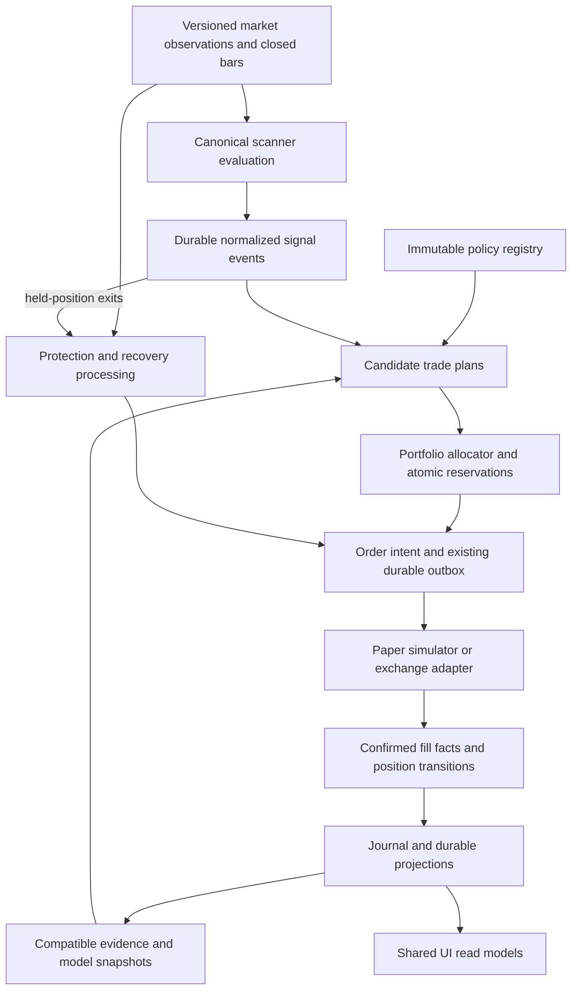

# VN EDGE: architecture recovery plan

6 November 2026. Code inspected at `71c5da0f2de490ade49a107124a131e64da0afbd`.
Status: architecture proposal and implementation backlog, not implemented or deployed.
This review covers the decision, evidence and execution paths; it is not a line-by-line
certification of every imported Pine script.

## Decision

Keep the modular monolith, SQLite journal, scanner registry, shared execution math and
exchange recovery machinery. Consolidate them around an immutable trade policy, a
replayable decision engine and one portfolio allocator. Finish these boundaries before
using another TP/SL sweep to change the account strategy.

The repeated experiments have three different causes to address:

1. **Unstable comparisons:** a trade's policy and the evidence used to qualify it are not
   consistently bound to the same version.
2. **Portfolio selection effects:** individually attractive scanner results do not describe
   which trades a constrained account actually takes.
3. **An unproven trading edge:** correctness improvements have not established sustained
   positive expectancy after costs. Architecture can make that question answerable; it
   cannot manufacture profitability.

Preserve the operator's $150 margin setting and current 3% stop-risk ceiling during this
migration. Treat 10–20 daily fills as an objective to measure, not an instruction to fill a
quota. No production trading activation is part of this proposal.

## Implementation status — 6 November 2026

This release implements the first reliability boundary across the existing bot:

- Accepted ordinary orders bind resolved fee, sizing, entry and exit settings to an immutable
  policy. Pending limits retain that policy across restart; open trades keep their settings.
  Archived scanner source and reading are used for exits when a scanner changes or is disabled.
  Existing positions are explicitly marked as adopted; their original rules are unknown.
- Resting orders reserve account margin and exposure. Rechecking an order at fill can shrink
  its quantity, but cannot increase it above the accepted reservation. Risk halts remain dynamic.
- Incubator qualification and leverage require compatible source and execution evidence.
  Account readiness additionally requires matching sizing, risk and ML configuration.
  Missing policy resolution cannot qualify historical data. The raw journal remains intact.
- Ready paper entry decisions share a 250 ms window with deterministic ordering and admission
  rechecks. This stabilizes the same ready-set; it does not reconstruct historical worker
  ordering or rank candidates by an established profit forecast. Exits bypass this queue.
- Risk close receipts recover missed callbacks idempotently. Loss-limit events are recorded
  even without forced closes. Readiness uses the actual configured drawdown alert threshold.
- Recorded execution inputs can replay through PaperEngine and RiskManager with an injected
  clock. The separate candle simulator has corrected entry/reversal timestamps and avoids
  processing an entry candle twice. Unsupported maker orders are rejected explicitly by
  an attached market-only executor rather than converted to market orders.
- Performance and Incubator show evidence compatibility, reservations and archived-exit
  failures. Existing results remain visible, but do not establish new-policy qualification.

Validation: all 903 server tests and 5 dashboard tests pass, together with dashboard
lint/build and targeted server TypeScript checks.
The cached historical chronology retest ran 396 scenarios and 7,357 closes, including all
36 continuation scenarios; no negative holding times or pre-entry fills remained. This is
chronology validation, not a new profitability study.

Still required: reconstruct complete signal/admission inputs for full runtime replay;
measure portfolio sensitivity across different ready windows; evaluate scalp/swing candidates
on fresh forward evidence; unify exchange intent before fill and certify its partial fills,
cancels, reconnects and restart reconciliation. The production readiness report still is not
an enforced, version-bound activation certificate. No live activation or new TP/SL strategy
is included. The $150 margin and 3% stop-risk cap remain in place.

The findings below describe the pre-change baseline and the full remaining target.

## Findings and evidence

| Finding | Verified implementation | Consequence and correction |
|---|---|---|
| Ordinary positions can re-read mutable settings | `PaperEngine.configFor()` falls back to current paper/scanner settings unless `executionPlan` exists. Tape, mark and candle management call it. [engine](../server/src/paper/engine.ts) | Entry-time fingerprints do not freeze subsequent behavior. Bind every accepted order and position to a resolved policy snapshot. |
| Research already has a useful snapshot pattern | `planSnapshot()` resolves overrides, captures source/reading and signs behavior; labels are excluded. [execution plans](../server/src/paper/executionPlans.ts) | Generalize the pattern, but do not copy its independent research purse and relaxed capacity settings into the account. |
| Evidence versioning does not control all decisions | `configFingerprint()` includes Git SHA; `IncubatorStore.trades()` and `PaperEngine.cellLeverage()` select by cell/book without compatible policy or source constraints. [fingerprint](../server/src/paper/fingerprint.ts), [store](../server/src/incubator/store.ts), [engine](../server/src/paper/engine.ts) | A UI-only commit changes the fingerprint, while materially different historical strategies can still inform promotion or leverage. Separate behavior identity from build provenance and require explicit evidence compatibility. |
| Account entry candidates are admitted individually | `applyDelivery()` applies pilot, trend and ML checks, then calls `paper.onEntry()`. Shadow has a separate scheduler and entry delivery. [account](../server/src/scanners/engine.ts), [shadow](../server/src/incubator/shadow.ts) | Arrival order competes for scarce account capacity. Add one deterministic portfolio decision boundary for contemporaneous entries. Preserve immediate protective processing. |
| Shared math does not mean shared orchestration | `paper/backtest.ts` has a simulation loop separate from `PaperEngine`. [backtest](../server/src/paper/backtest.ts) | Timeline, admission and lifecycle differences can survive unit tests of shared helpers. Feed recorded inputs through the same decision transitions used at runtime. |
| Attaching an executor changes entry semantics | `App` disables account maker limits when an executor exists; `entryPolicy()` documents market entry for mirrored accounts; executor `enter()` sends `market_order` from a paper fill. [composition](../server/src/app.ts), [policy](../server/src/paper/policy.ts), [executor](../server/src/execution/testnet.ts) | Paper maker economics are not proof of the exchange strategy. Persist order intent before any simulated or exchange fill; adapters must honor that intent or report unsupported. |
| Exchange commands already have a durable outbox | `ExecutionOutbox.record()` requires the paper-fill transaction; the executor recovers through its order ledger. [outbox](../server/src/execution/outbox.ts), [ledger](../server/src/execution/ledger.ts) | Extend the existing mechanism. Do not build another order ledger. Remaining callback consumers need durable cursors or transactional updates. |
| Readiness is a report, not the production entry authority | The sole non-test `goLive()` caller builds analytics. `createExecutor()` selects mode/host/credentials without that verdict. Readiness also takes its drawdown threshold from `ddScale[0]` and counts historical halts through forced closes. [app](../server/src/app.ts), [readiness](../server/src/analytics/golive.ts), [executor](../server/src/execution/testnet.ts) | Repair the calculation and enforce a version-bound readiness prerequisite for production entries. Existing explicit host locks remain. Exits and reconciliation must remain available when entry readiness fails. |

### What the recent replay establishes

The 6 November study accepted 360 candle runs, ran 26 shared-account scenarios and
performed a sizing-only sensitivity on 775 historical closes. Its verification artifact
records 36 excluded continuation runs with chronology failures. Those runs cannot qualify
a policy until repaired and rerun.

In the later 28-day shared-account window, the current-policy scenario at the study's
0.10% crossing assumption returned **+$252.04**, versus **+$58.61** when simultaneous
candidate ordering was reversed. This is modeled sensitivity, not reconstructed historical
worker ordering. It establishes that allocator behavior is material. A tested ranking by
prior results did not consistently solve it.

The earlier window lost money. The 1h partial-exit follow-up was exploratory, and the
historical windows have already been inspected. Neither those results nor a lower stop
count supplies a fresh holdout or a production qualification.

Study artifacts: [report](/Users/scorpion/Documents/Codex/2026-10-24/https-github-com-vikkl1990-vela-vnedge/work/backtest-20261106/report.html),
[portfolio results](/Users/scorpion/Documents/Codex/2026-10-24/https-github-com-vikkl1990-vela-vnedge/work/backtest-20261106/portfolio-analysis.json),
[verification](/Users/scorpion/Documents/Codex/2026-10-24/https-github-com-vikkl1990-vela-vnedge/work/backtest-20261106/verification.json).
These local artifacts use assumed historical crossing, incomplete historical funding and
current source/contract specifications; they do not reconstruct the historical allocation,
ML, depth or exchange queue. The paths are local workspace references, not portable repo assets.

## Target decision path

These are module boundaries, not a proposal for separate network services. Run heavy
research and training in bounded worker processes; keep the execution coordinator and
transaction owner explicit. Reuse `logic.ts`, `costs.ts`, `policy.ts`, the inbox, outbox,
order ledger, scanner profiles and Incubator rather than creating competing replacements.

### 1. A versioned policy and a concrete trade plan

Separate three identities:

| Identity | Contents and responsibility |
|---|---|
| Strategy policy | Scanner source and reader versions, inputs, direction/TF/profile, entry method, invalidation, exit rules, feature/model requirements and behavior versions. Immutable. |
| Evidence manifest | Strategy identity, book/capital model, fill/cost assumptions, market-spec and data versions, observation cutoffs, coverage and exclusions. Used to decide compatibility. |
| Trade plan | Policy reference, source event, observed market/spec/quote versions, actual rounded contracts, leverage, reserved margin, stop risk, targets/exit rules, expiry and evidence/model references used for this decision. Immutable intent plus subsequent lifecycle events. |

Keep Git SHA as diagnostic provenance. Do not make a documentation deployment invalidate
identical behavior. Conversely, do not pool different sources, fill mechanics or exit rules
just because the scanner name is unchanged.

An open position continues its bound management policy across config edits and restarts.
If management depends on script exits, retain the bound source/reading version for those
evaluations too. Emergency reduce/close commands and current account safety limits remain
effective independently of the frozen strategy. Any deliberate position migration is an
explicit journaled command, never an incidental config reload.

Freeze simulation assumptions; record actual exchange commissions and funding as facts,
including later corrections. Freezing a policy must not override what the exchange charged.

Legacy pending/open positions need a snapshot of the effective policy at migration, labeled
`adopted_at_migration`. Do not claim that this reconstructs their original entry-time rules.
Retain old history as legacy evidence; do not erase it or relabel it as verified.

### 2. One source event, with explicit scanner roles

Normalize events once for a source version, input set, market, timeframe, completed bar and
event discriminator. Preserve multiple distinct partial-exit events. Fan the same event out
to research, paper and diagnostics with their own explicit policies and capital contexts.

Extend existing profiles and contribution views with an executable contract: entry,
confirmation, regime/context, level provider or position management. A context-only script
is useful without opening a position. Aliases and correlated signals must not become
independent votes or duplicate risk. Verify closed-bar behavior and prefix stability for
each source/reader revision; label unsupported external data rather than substituting zeros.

Frames are as-of context: an entry can use only information available at its decision time.
A developing 1h/4h bar must not be presented as a completed higher-timeframe confirmation.
Record unavailable context and the policy's explicit behavior when it is unavailable.

Unify computation incrementally. The existing inbox event identity remains authoritative
while schedulers migrate; a scanner refactor must never duplicate account delivery.

### 3. One portfolio allocator, with useful alternatives to a refusal

Separate validity, economic qualification and capacity selection. Existing position caps,
correlation limits and loss limits remain owned by the risk layer; the allocator plans around
them instead of racing individual admissions against them.

Within a bounded entry decision interval, collect contemporaneous eligible candidates,
group duplicate exposure, evaluate available capital and record the selected set with stable
tie-breaks. Preserve observed-at timestamps, the interval deadline and late/missing workers.
Shuffling the same eligible inputs inside the same boundary must not change selections.
Inputs arriving after the deadline are a different information set, not a parity failure.
The interval must be measured against latency tolerance, not chosen as an arbitrary delay.

Protective exits, confirmed fills and reconciliation bypass this entry batching. Pending
orders reserve margin and exposure atomically. For exchange orders, a cancellation request
does not release resources until cancellation or the final fill outcome is established.
Distinguish daily attempts, pending reservations and actual fills so an expired maker order
does not silently count as a completed trade; retain a separate limit on repeated attempts.

Each candidate's economic assessment uses its deployable quantity and intended holding
horizon: entry/exit commissions, crossing, impact, funding scenarios, contract rounding,
partial-exit cash flows, invalidation risk and break-even. Preserve uncertainty explicitly.
The current fill budget already records some of these quantities, but says funding/exit
impact are unestimated and treats each target as an independent full-size outcome.

Where a candidate is uneconomic, a versioned policy may offer a tested resting entry,
smaller quantity when depth is the constraint, or waiting for a better setup. Smaller size
does not solve a proportional fee-to-edge problem. These alternatives require fill-rate and
adverse-selection evidence. Never widen a stop merely to pass a fee ratio, move a target
farther away to invent reward, or relax liquidity until a daily trade quota is met.

Start with explicit deterministic priorities and audit them. Expected net payoff, holding
time, uncertainty and exposure can later inform ranking, but a new scoring formula is a
strategy experiment and needs its own evidence.

### 4. One decision engine, different fill adapters

Incrementally extract the runtime transitions into a deterministic core with an injected
clock and explicit market, policy, portfolio and risk inputs. The backtester feeds this core
recorded observations. Move pure indicators used by risk out of the backtest orchestration
module. The paper adapter supplies simulated fill facts; the exchange adapter supplies
exchange-confirmed facts. A simulated fill is never evidence of an exchange fill.

Keep separate times for bar close, observation, decision, submission/activation and fill.
No fill can precede activation. A completed-bar strategy cannot use that bar's earlier low
to fill an order created at its close. Ambiguous intrabar paths need an explicit conservative
model and sensitivity bounds; minute OHLC cannot establish exact queue priority.

The canonical sequence is candidate → reservation → intent → acknowledgement/fill facts
→ position accounting. Partial fills, cancellation in flight and uncertain submissions are
first-class states. Reuse the existing outbox and exchange ledger to achieve idempotent
effects under retry; do not assume the transport delivers exactly once.

Parity means identical decisions for identical inputs and state, and identical simulated
fills when using the same fill model. It does not mean live fills must equal a backtest.

### 5. One evidence and promotion authority

Make Incubator the owner of strategy-policy eligibility and experiment promotion. The
portfolio allocator owns each account's actual capital assignment. Decisions is a view and
command surface for these owners. No UI, tuning CLI or ML retrain may silently promote a
different policy.

Progression: source verified → research → bounded paper pilot → qualified paper allocation
→ testnet-certified policy/adapter → explicitly authorized live pilot. Existing cell stages
can remain during migration; add policy-instance qualification rather than relabeling all
historical cells. Pilot evidence, capital limits and outcomes remain distinct from full allocation.

Use one compatibility-aware evidence query for promotion, leverage, ML evaluation and
readiness. Return the included and excluded counts with reasons. Unlimited shadow research
measures opportunity behavior; shared-account replay measures portfolio feasibility. They
are different experiments even if their entry and exit rules match.

Every prospective change needs a registered hypothesis, frozen control, exact policy and
data manifests, declared costs, primary outcome, acceptable drawdown, sample plan and
rollback condition. Choose these before inspecting its test results. Analyze correlated
trades in time/market groups; overlapping scanner trades are not independent observations.
After repeated reuse of historical windows, qualification requires fresh forward evidence.

Scalp and swing become explicit strategy profiles with different setup, holding horizon,
invalidation and exit behavior. Do not equate a timeframe with a universal TP/SL setting.
Start with a small number of interpretable policy families; use per-pair overrides only when
their incremental benefit survives prospective evaluation.

ML should earn authority through an incremental comparison against the same policy without
its score. Record model/training cutoff and features at entry; exclude future outcomes and
incompatible policy labels. Win probability alone does not measure after-cost expectancy.
Initially evaluate any new ML policy in observation mode; do not silently change existing
ML admission behavior as part of a structural refactor.

### 6. Operations, production readiness and UI

Research queues must not delay protection. Load-test feed processing, signal lag, protection
lag, queue age, memory and database contention at the configured maximum research load.
Publish measured latency budgets and test against them. Scheduler shutdown stops new
intake, drains or cancels jobs, and preserves responsibility for held exposure.

Move post-commit projections onto durable, idempotent consumer cursors. Safety-critical
balances/reservations belong in the decision transaction; safety bookkeeping must catch up
before new entry decisions after restart. Learning, alerts and reports must not be the only
holders of facts needed to reconstruct risk.

Production readiness has two independent requirements: qualified trading policy and tested
execution mechanics. Bind certification to policy, adapter, account and relevant versions;
invalidate affected certification when those change. Test rejected/partial/uncertain orders,
disconnects, restarts, quantity changes, protection failure and reconciliation on testnet.
Keep production locks and explicit operator activation. Current production market-only
restrictions require a separately tested path for exchange-held protective stops; a green
analytics card does not establish protection during a bot outage.

Unify read models before reorganizing navigation. The current pages mostly share services;
the issue is not nine independent bots. Suggested grouping:

| Group | Existing surfaces and purpose |
|---|---|
| Operate | Account, active orders/protection and the current decision funnel |
| Strategies | Library, scanner contracts, versions and pair/TF coverage |
| Research | Incubator, Decisions, Learn and controlled comparisons |
| Journal / Performance | Auditable decisions, fills, costs and outcomes by compatible cohort |

Keep existing deep links. Make every trade traceable through event → policy → evidence →
allocation → reservation → order → fills → net result. A quiet pair must show the exact
stage: not scheduled, unhealthy, evaluated/no event, context-only, unqualified, too costly,
lost capacity, resting, expired or filled. Use consistent time windows and distinguish
entries from closes; provide dated snapshots rather than unrelated live counters.

## Delivery sequence and acceptance criteria

Each stage is a reviewable change. Structural stages preserve strategy settings; a strategy
change gets its own experiment and decision record.

| Stage | Work and existing code to extend | Acceptance before advancing |
|---|---|---|
| A — Bind policy and evidence | Generalize `executionPlans`, resolve ordinary policy once, add behavior identity and compatibility queries; adopt pending/open positions explicitly. Wire Incubator/leverage/readiness to the new query in comparison mode first. | Config/source changes cannot silently change held strategy management. Restart preserves the binding. UI-only commits retain identity; behavioral changes alter it. Legacy evidence remains visible but cannot silently qualify a new policy. |
| B — Reproducible account decisions | Extract common transitions from `PaperEngine`; add recorded-event replay and unified event timing; quarantine/fix chronology failures; replay account capital/risk/reservations. | Same inputs produce the same decisions and accounting; no exit before entry; no pre-order fill; duplicate/restarted delivery has one effect; fees and all partial quantities reconcile. |
| C — Deterministic allocation | Route account/mirror entries through one allocator, reserve pending exposure atomically, record decision windows and selection reasons. Deduplicate shared scanner work incrementally. | Arrival permutation within a fixed boundary yields identical selections; bounded deadline behavior is recorded; protection is never batched; cancel/fill races cannot overspend; no pair starves merely because of fixed iteration order. Compare throughput and latency before enabling. |
| D — Controlled economics and strategy improvement | Build concrete pre-trade cost scenarios; qualify scalp/swing policy families through Incubator; evaluate scanner roles, maker alternatives, TP/SL and ML against a fixed control. | Compatible net portfolio results, uncertainty, concentration, drawdown, realized costs and completed fill rate are reported. New forward data supports promotion under predefined criteria. Fewer SL labels or more entries alone cannot pass. |
| E — Exchange intent and certification | Extend the existing outbox from paper-fill mirroring to intent-first dispatch; adapters enforce capabilities; repair/enforce readiness; test exchange-held protection and recovery. | Maker policy never silently becomes market; partial and uncertain outcomes reconcile; exposure remains protected or follows a tested emergency procedure; readiness failure stops new entries without disabling reductions. Testnet evidence retained. |

UI explanations, journal provenance and operational instrumentation accompany every stage.
Stage E's design and failure tests can proceed alongside A–C, but production activation
depends on qualified policy evidence as well as execution certification.

### First implementation slice

Build Stage A first, with no TP/SL, sizing, leverage-threshold or admission-threshold edits:

1. Introduce a general resolved policy snapshot separate from research-only plan settings.
   Bind it when accepting ordinary pending or immediate-entry intent; carry it into fills.
2. Make management read the bound policy. Preserve dynamic emergency risk controls and
   explicitly migrate legacy held/pending positions with their adoption timestamp.
3. Add semantic behavior identity and an evidence manifest. Keep the old fingerprint for
   audit compatibility; do not rehash old rows into invented new identities.
4. Add compatibility-aware query results and compare Incubator/leverage outputs with today's
   selection. Expose differences before switching decision authority, including insufficient
   compatible evidence and the deliberately chosen fallback.
5. Cover ordinary entries, maker pending orders, held script exits, restart, source/config
   changes and legacy adoption. Extend existing engine, limit-entry, fingerprint and
   execution-plan tests rather than starting a separate test framework.

The next slice is recorded-event parity. The exploratory 1h partial-exit result stays a
research candidate until these foundations can evaluate it without unrelated policy drift.

## Migration and rollback rules

- Use additive schema migrations and a verified database backup. Preserve the existing
  journals and account reset generation; never reset the account to simplify migration.
- Run the new decision path as an observer first. Only one path may write executable
  intents. Compare decisions with shared event/plan IDs and explicit reason categories.
- Cut over new entries at a recorded boundary. Existing positions keep their owner and
  management policy until flat or explicitly migrated. Only one consumer may dispatch an
  intent; stable keys must survive retries and deployment restarts.
- On rollback, stop new intake, retain protection/recovery and reconcile uncertain orders.
  Do not roll an old binary over schema/state it cannot read. Keep the compatibility handler
  until all new-policy positions are flat; validate the downgrade procedure in rehearsal.
- Retire superseded backtest orchestration and alternate qualification paths only after
  parity and dependency checks. Keep research utilities clearly advisory. Do not remove
  scanners solely because they are context providers or their old policy lost money.

## Completion criteria

The architecture work is complete when a trade and a refusal can be reproduced from
recorded inputs; every position has an explicit policy owner; evidence decisions cite
compatible cohorts; account selections are deterministic for the same information set;
order/fill/accounting state survives failure; and every screen reads those same facts.

Trading improvement is a separate outcome: a fixed policy demonstrates positive after-cost
portfolio expectancy with acceptable drawdown and concentration on genuinely new evidence.
If it cannot generate enough qualified opportunities, the response is to improve source
coverage, setup design or execution economics with a controlled experiment—not to report
more signals as success.
