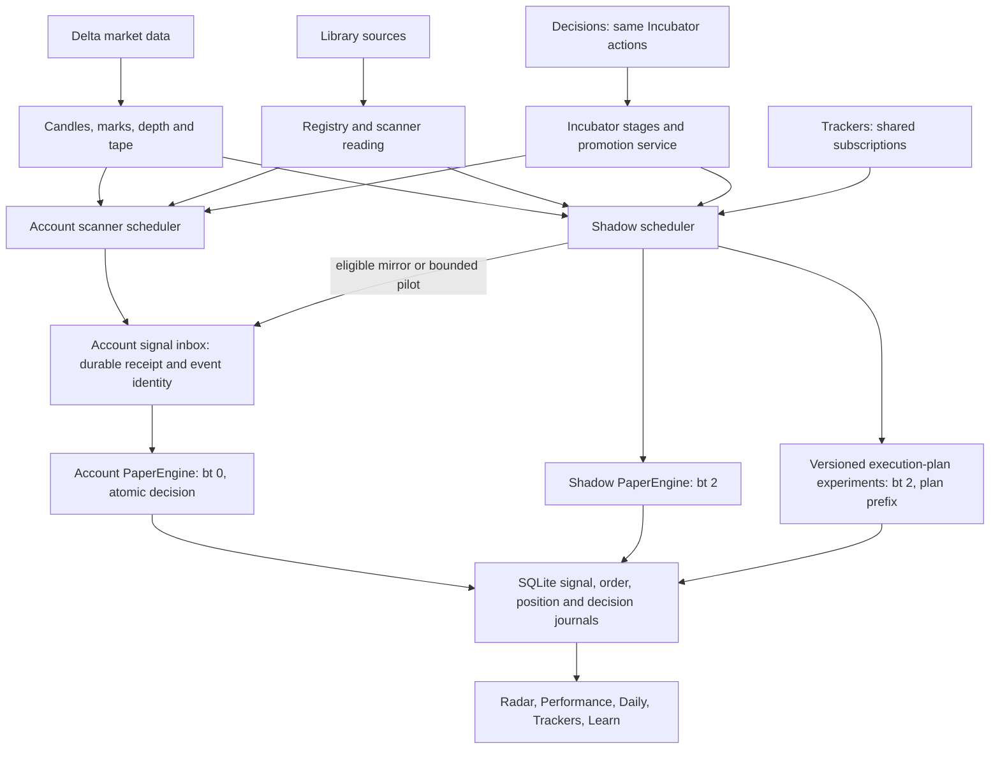

# VN EDGE architecture

Current ownership audit: 31 October 2026 (decisions 206–207). The application is a modular
monolith. Pages are views and controls over shared services, not independent bots.

## Control and evidence boundaries

| Surface | Responsibility | May change account allocation? |
|---|---|---|
| Library | Source discovery, versions, imports and favorites | No |
| Scanners | Inputs, signal interpretation, explicit operator allocations | Yes, explicit operator changes; backtest review is advisory while Incubator is enabled |
| Incubator | Candidate stages, screening, forward shadow evidence, promotion policy | Yes, the automated allocator and approval service |
| Decisions | Ranked Incubator proposals, clocks and runtime faults | Calls the same Incubator actions; no second allocator |
| Trackers | Named subscriptions to cells in the shared shadow runner | No; multiple lists share a cell and its trades |
| Radar | Coverage, signal refusals, filled activity from account and shadow | No |
| Performance / Daily | Closed account and ordinary shadow results after costs | No |
| Learn | Model fitting, calibration, score and outcome diagnostics | No allocations; configured ML settings can influence entry admission |



Account and shadow currently still have separate run schedulers. They share PinePool,
market data and execution-policy primitives. A mirrored event must enter through the
account's ordinary admission method, not through a second account fill path. Source event
identity is independent of the mirror attribution label, including partial script exits.
This prevents duplicate delivery; it does not deduplicate every Pine computation.

Account ingress saves a durable `signal_inbox` receipt before asynchronous depth preparation.
The signal outcome, paper order/position changes, pilot counter and receipt completion share
one SQLite transaction. Failure restores PaperEngine and admission risk state in memory;
order/position notifications and success logs follow commit. Pending payloads retain source,
policy, original position/pending IDs and the account reset generation, then are cleared on
completion. Completed event identities remain available for duplicate detection.

Startup and a five-second timer retry pending receipts, with exits first. Entries expire after
at most 60 seconds, require unchanged source/policy/account reset generation, and recheck current
admission against fresh prices. A recovered exit can touch only its original held position.
Recovery pauses outside paper mode; live exchange reconciliation is a separate responsibility.
Signals shows pending decisions and errors; Decisions flags failed or older pending work.
Existing pre-inbox signals are not replayed because their original target bindings are unknown.
Seven forced process kills cover receipt, entry/partial-exit/maker before and after commit;
additional tests cover rollback, reversals, reset and price/policy/source changes.

Trackers are many-to-many membership, not multiple balances. Membership/stage changes
commit atomically; a shared tracked cell is released only after its last owner leaves.
Account allocations and held positions are not released by tracker removal. Retired cells
can remain visible in a watch list; membership does not automatically undo a screen's retirement.

`positions.evidence_scope` freezes the reporting role when the order receives its cell
identity, including pending orders. New roles are account, shadow, tracker, experiment or
other. Pre-existing rows are classified once at migration; `legacy-shadow` and
`legacy-tracker` explicitly mean inferred at migration, not reconstructed entry-time stage.
Moving a cell later cannot rewrite Daily/Performance history. Trackers can include cells
also present in ordinary shadow or the account: their views are not additive portfolios.
Radar counts filled ordinary account/shadow positions (including watched cells), excluding
pending/cancelled orders and plan variants. Learn includes watch-only outcomes and is a
different cohort from Performance. These differences are intentional and explained in the UI.

`App` composes `validation/runtime.ts` before HTTP registration. Routes only expose that
instance. The historical `validation/shadow.ts` ungated/ml-gated ledger is read-only and no
longer subscribes to prices/signals. Its old fill model was independent of current execution
plans. Existing snapshots remain readable; the reset API returns 409. Current ML fitting and
scores remain available. Incubator-enabled Auto-tune returns recommendations without writing
scanner allocations. Explicit legacy pair tuning, when Incubator is off, keeps passing cells
rather than a Cartesian product of passing symbols and timeframes.

## Remaining production work

These changes remove confirmed conflicts, but are not a production-readiness certification:

1. Extend durable event recovery to the shadow scheduler and post-commit consumers. The account
   receipt/decision boundary now recovers without duplicate paper fills. Observer delivery to
   learning, risk close bookkeeping, alerts and exchange commands is not yet a durable outbox:
   a kill after commit can miss a callback. Recover those consumers from the committed journal
   with independent cursors, and reconcile exchange state before any live replay. Pending
   market/tape entries retain their existing cancel-on-restart policy; maker limits reload.
2. Key cached backtests/walk-forward evidence by source hash, inputs, signal reader, policy,
   cost model and market-data window. Current simulation-version checks do not capture all
   configuration changes. Promotion must cite the exact evidence version it used.
3. Run ML fitting and large replays outside the market-data event loop. Measure close-to-scan,
   signal-to-decision, queue age and feed lag under full research load; reserve execution capacity.
   Pine workers alone do not isolate all synchronous post-processing/training.
4. Unify execution scheduling for identical source/input/cell requests, then fan out the same
   event to separately versioned books. Preserve held-position exits during any migration.
5. Complete component lifecycle ownership: stop intake before draining work, cancel/await
   research jobs, detach listeners and stop all timers. Validation now has an owned stop path;
   the whole application's shutdown/restart-in-one-process contract is not yet complete.

```
Delta Exchange India ──REST (history, products, tickers)──┐
   wss://socket.india.delta.exchange ──candlestick_*/ticker─┤
        (all_trades / mark_price / funding_rate ───────────┼──► MarkStore + PaperEngine tape path)
                                                            ▼
                                                   CandleStore (per symbol×tf ring buffer)
                                                     │ 'closed' bar events
                                                     ▼
                                      ScannerEngine (scanner × symbol × tf)
                                          │ job {patched Pine source, closed bars}
                                          ▼
                                 PinePool → worker_threads → PineTS runtime
                                          │ alerts / plotshapes / labels / plots
                                          ▼
                                     extractor.ts  (alert-message parser)
                                          │ ScanEvent {entry|exit|info, side, price, sl, tp[], score}
                                          ▼
                              RiskManager (kill switches, caps, cooldown, regime, dd scaling, beta cap)
                                          │ gate() / exposureCheck()
                                          ▼
                    PaperEngine (live, SQLite)   ←── tape prints (or 1m candles) ──  fills: liq(mark) → SL → TP1/2/3 → BE, funding
                    Backtester (in-memory, same logic.ts)
                                          │ order / position events
                                          ├──► ExchangeExecutor (dry-run | demo): market mirror, reduce-only brackets, reconciliation
                                          ▼
                              ApiServer (REST + SSE) ──► dashboard (Vite/React + Vela chart)
```

## Components (server/src)

| Module | Responsibility |
|---|---|
| `config.ts` | Defaults, validation, persisted `data/config.json`, timeframe maps (Delta ↔ Pine). |
| `delta/rest.ts` | Dependency-free REST client (public + HMAC-signed), candle paging. |
| `delta/ws.ts` | Websocket feed with reconnect, subscription replay, heartbeat watchdog. Channels: `candlestick_*`, `v2/ticker`, `all_trades` (tape → `trade`), `mark_price` (`MARK:` symbols → `mark`), `funding_rate` (→ `funding`). |
| `data/marks.ts` | `MarkStore`: exchange mark price and funding state per symbol; `dueFunding()` hands out one charge per 8 h realization slot. |
| `data/candleStore.ts` | Backfill + live merge; emits `bar` (forming) and `closed` exactly once per bar. |
| `pine/patches.ts` | Source-level compatibility rewrites for PineTS (listed per scanner in the API). |
| `pine/provider.ts` | PineTS `IProvider` over Delta candles incl. `request.security()` timeframes (monthly aggregated from daily). |
| `pine/worker.ts` / `pool.ts` | Isolated script execution with timeouts and crash recovery. |
| `scanners/registry.ts` | Loads `scripts/manifest.json` + Pine sources, categories, patch application. |
| `scanners/extractor.ts` | Parses the scripts' structured `alert()` messages and plotshapes into events. |
| `scanners/engine.ts` | Orchestrates runs on bar close, dedupes signals, warm-up backtests, overlays. |
| `paper/logic.ts` | Pure fill logic: levels, sizing, TP legs, break-even, stats. |
| `paper/engine.ts` | Live paper account persisted to SQLite (`node:sqlite`). `fillSource: tape` adds pending entries (latency), print-driven stops/targets, mark-price liquidation, funding charges and the 1m-candle fallback. |
| `risk/manager.ts` | Portfolio risk layer (phase 3): daily/weekly kill switch, manual halt, position caps, per-scanner budget, cooldown, drawdown-scaled sizing, regime filter, BTC-beta exposure cap (`risk/correlation.ts`). State in the kv table. |
| `risk/routes.ts` | `/api/risk*`, `/api/execution*`, `/api/marks` (registered through `api/extensions.ts`). |
| `execution/client.ts` | Exchange transports: `RestTransport` (demo host; production only via `allowProduction` + `DELTA_LIVE=1`, then market orders / reduce-only exits only) and `DryRunTransport` (records payloads). |
| `execution/wiring.ts` | Feed → engine wiring for the tape/mark/funding channels and the 5 s scheduler (funding charges, pending-entry expiry, risk ticks). |
| `paper/backtest.ts` | Deterministic bar-level replay with the same logic. |
| `execution/testnet.ts` | `ExchangeExecutor` (phase 5): mirrors entries/discretionary exits as market orders, places reduce-only stop + take-profit brackets per paper position (replaced on break-even / partial fills), reconciles exchange positions and open orders on a timer, emergency close-all. Off in `paper` mode. |
| `api/server.ts` | HTTP router, SSE broadcaster, static dashboard hosting. |
| `api/extensions.ts` | One-line registration of feature-module routes (`validation/routes.ts`). |
| `data/candleCache.ts` | SQLite candle cache (`candles` table): pages Delta REST in 4,000-bar chunks, sequential per symbol with delays, serves 60–90 days without refetching; deep source for warm backtests (`validation.history.backtestBars`). |
| `validation/walkForward.ts` | Rolling train/test windows over a long history, each replayed with `runBacktest`; in-sample selection → out-of-sample aggregation, positive weeks, de-duplicated trades. |
| `validation/service.ts` | Runs walk-forward for every scanner×symbol×tf, persists `walk_forward`, feeds OOS summaries to the engine's auto-tune. |
| `validation/runtime.ts` / `shadow.ts` | App-owned validation composition; legacy ML ledgers are archived read-only. |
| `validation/consensus.ts` | Optional entry filter: N distinct scanners must agree on side/symbol/tf within a window. |
| `pine/inputs.ts` | Parses `input.*()` declarations from Pine; validates per-scanner overrides that the worker applies through PineTS's `Indicator.input`. |
| `ml/model.ts` / `ml/service.ts` | Logistic regression with a time-ordered holdout, Platt calibration, reliability buckets, and live feature-drift monitoring. |
| `log.ts` | Console (text or `LOG_FORMAT=json`), ring buffer for `/api/logs`, size-rotated `data/logs/vnedge.log`, per-level counters. |
| `db.ts` | SQLite schema + helpers; Phase 4 adds `backup()` (`VACUUM INTO`), retention pruning, `integrityCheck()`, statement-error counters. |
| `ops/service.ts` | Composition of the ops modules below; `status()` feeds `/api/health`; `shutdown()` drains in-flight script runs with a timeout. |
| `ops/metrics.ts` | Dependency-free Prometheus registry (counters, sampled gauges, event-loop lag, CPU). |
| `ops/alerts.ts` | Telegram transport, per-key de-duplication, repeat interval, hourly cap, "resolved" notes. Token never logged. |
| `ops/monitor.ts` | Alert conditions on a 15 s timer (feed, crash loop, queue depth, drawdown, stale bars, disk, db errors), daily summary, per-trade notes. |
| `ops/backup.ts` | Nightly snapshot scheduler with persisted last-run and on-demand runs. |
| `ops/workers.ts` | Worker factory handed to `PinePool` so respawns can be counted without touching the pool. |
| `ops/routes.ts` | `/api/metrics`, `/api/ops/*`; `attachRawMetrics` serves the text exposition ahead of the JSON router. |

## Signal semantics

* Scripts run on **closed bars only**; the forming bar is never fed to a script, so a signal is
  emitted once, right after the bar that produced it closes (TradingView "once per bar close").
* Alerts are parsed generically: a leading 🟢/🔴 plus LONG/BUY/SHORT/SELL words → entry; `SL:`,
  `TP1..3:` (or `TP:`) → levels; `TP1 HIT`, `SL HIT`, `BE STOP-OUT`, `REVERSAL`, SATS `flip_exit` → exits.
* `scanners/rules.ts` derives entries for scripts that never phrase a trade call: AMD Po3
  (`DIST ▲/▼` with Entry/Stop/Target), Adaptive Pivot Structure (CHoCH reversals), Adaptive
  Squeeze Momentum (`SQUEEZE FIRED · Direction`), Daily Volume Profile (80% rule + target),
  Automatic Fibonacci Levels (`ENTRY ZONE`, direction/targets from TP labels), Auto S/R
  Channels (`Breakout ▲/▼` + 🎯 label), Structure-Anchored VWAP (HL/LH labels, confirmed
  5 bars after the pivot in backtests, on first appearance live), Elliott Impulse (live only:
  projection labels give stop and targets). Bitcoin Almanac (cycle timing) and Trade Strategy
  Calculator (a sizing tool) have nothing tradeable and stay informational.
* Scripts that only draw `plotshape(Buy/Sell)` fall back to shape hits; missing levels use
  the resolved scanner/timeframe policy and ATR fallback; defaults and overrides live in `config.ts` and `paper/policy.ts`.
* One position per scanner×symbol×timeframe; an opposite signal reverses when `allowReversal`.

## Paper fills

* Entries use the resolved market/limit/reclaim plan, current quotes and explicit fill eligibility; maker/taker fees follow the actual modeled fill type. See `paper/policy.ts`, `entryPlan.ts` and `engine.ts`.
* Every 1-minute candle update of the symbol is applied to open positions: SL first (worst case),
  then the frozen target legs, break-even and trailing policy. Allocation and trail activation are scanner/timeframe/plan specific.
* Script exits are honoured according to the scanner's `exitMode`: `levels` ignores the script's exit events and trades the bot's levels; `both` trades the bot's levels and closes on the script's exits too; `script` (decision 113) trades the script's own exits only — no bot target, trail, floor or time stop, and a disaster stop of `paper.scriptDisasterStopAtr` × ATR when the script publishes none.
* **Dashboard payloads**: `GET /api/scanners` carries per-scanner statistics and symbol lists for every
  script on disk, which is what the scanner pages need and roughly a hundred times what a name lookup
  needs. `?view=lite` returns id, name, status, category, enabled, hidden, overlay and the last run's
  error only; the header, the Overview fleet panel, the signal and trade filters and the chart picker
  use it. The full list is built from one pass over closed positions, one grouped signal count, one
  pass over backtests and one over last-runs, rather than scanning each per scanner. Responses over
  1 KiB are gzipped when the client asks (never SSE), and hashed build assets are immutable for a year.

* **Execution guards** (added after the latency audit):
  - *Quotes*: the top of book is taken from `v2/ticker` (`quotes.best_bid`/`best_ask`), not `mark_price`, which carries none on Delta India. Entries cross the spread when a quote is fresher than `paper.quoteMaxAgeMs`; otherwise they fall back to the slippage model, and `paper.requireQuote` refuses them instead. Exits never require a quote, so a position is always closable. `entries_priced_on_quote_total`, `entries_priced_on_slippage_total` and `symbols_quoted` make a silent book outage visible.
  - *Historical bars*: a 1m bar that a resync or gap fill pulled from REST is flagged `historical`. It may still exit an open position (those prices really traded) but the fill is stamped at the bar's close rather than at receipt, it never fills a pending entry, and it never becomes the live mark.
  - *Pending entries*: the portfolio risk layer is consulted again at fill time (halt, caps, cooldown, drawdown scaling), not only when the entry was queued, and the expiry deadline is enforced inside the fill path rather than only by the housekeeping tick.
  - *Scanner backlog*: a bar that closes while that scanner/symbol/timeframe is still running is held as one deferred run and dispatched when the job finishes, instead of being dropped with its entries and script exits.

* **Tape mode** (`paper.fillSource: "tape"`): an entry becomes *pending* and fills at the first `all_trades` print after signal time + `latencyMs`; stops trigger on the last trade and fill at that print (a stop-market can fill through a gap); TP legs are resting limits that fill at their level once a print goes beyond it (`limitFill: through`) or touches it (`touch`); liquidation is checked against the exchange **mark price**; funding (`rate × notional`, sign by side) is charged at every 8 h realization; market fills add `notional / depthUsdPerBp` bps of impact. When no print arrives for `tapeFallbackMs` the 1m candle path takes over (only movement since the last print counts). `candles` (default) reproduces the legacy behaviour exactly.

## Risk layer

Every entry passes `RiskManager.gate()` inside `PaperEngine.onEntry` (after level/fee checks, before sizing) and `exposureCheck()` after sizing. Rejections are written to the signal as `rejected:risk <reason>` and listed under `GET /api/risk`. The layer never touches open positions except when `closeAllOnKill` or a manual kill with `closeAll` flattens the book.

## Execution path

`paper` → nothing leaves the process. `dry-run` → the executor runs with a transport that logs every payload (`GET /api/execution` shows them) and, if demo keys are present, still reads positions/orders for reconciliation. `testnet` → orders go to the demo host. The production host is unreachable unless `execution.allowProduction: true` **and** `DELTA_LIVE=1`; the transport then refuses any order that is not a plain market order and any non-entry order that is not reduce-only, so the bot can never leave resting orders on a real account.

## Validation loop (Phase 1)

```
CandleCache (SQLite, 60–90 d)  ──bars──▶  PinePool (one run per scanner×symbol×tf over the whole history)
                                             │ events (alerts, shapes, derived rules)
                                             ▼
                        walkForward(): windows [train 10 d | test 3 d] rolled daily
                                             │ per window: runBacktest(train) → selected?  runBacktest(test)
                                             ▼
                 walk_forward table ──▶ Auto-tune recommendations (allocation changes only when Incubator is off)
```

* **Honest numbers**: `outOfSample` only counts test windows whose preceding training window the tuner would have selected, so it is the return of *following the tuner*, not of the script. `outOfSampleAll` is the unconditional figure. Overlapping test windows are de-duplicated by entry time.
* **Auto-tune is advisory while Incubator is enabled**, including both manual APIs; scheduled tuning is skipped. When Incubator is off, it still skips unmeasured scanners: a scanner with no backtest for any of its pairs is reported as `skipped` and left untouched. Enabling a scanner starts a background warm-up and then a tune; without this, a tune triggered by a later enable would see the earlier one at zero trades and disable it.
* **Auto-tune rules**: in-sample (default, unchanged behaviour) or OOS (`autoTune.oos.enabled`): keep a pair when OOS trades ≥ min, PF ≥ min, positive weeks ≥ min and pnl > 0. Missing walk-forward data → in-sample fallback marked `provisional` in the report. `autoTune.tuneTimeframes` evaluates every (symbol, tf) pair and tunes both lists.
* **Deep warm backtests**: `validation.history.backtestBars` > `historyBars` makes the engine run the *backtest* over cached history; the live run always uses the in-memory bars (a second, short script run when both are needed in one warm-up).
* **Legacy ML ledgers** in `kv` are archived. Current forward evidence runs through the Incubator PaperEngine and explicit versioned experiments.
* **Consensus** is an `EntryFilter` the engine calls before the ML gate and the paper engine; off by default.

## Scanner quality (Phase 6)

* **ML**: `trainLogReg` fits on the oldest 80 % of samples by time and reports every metric on the newest 20 %, fits Platt scaling on that holdout and stores reliability buckets before/after; `MlService.score()` returns the calibrated probability and records the feature vector in a 200-sample ring used by `drift()` (per-feature mean/std vs. the training distribution).
* **Script inputs**: `scanners.<id>.inputs` travels in the `WorkerJob`; the worker builds a PineTS `Indicator`, writes each override through `indicator.input[name|title]` (validated by PineTS) and runs it. Invalid overrides fail the run loudly.
* **Generic rules** (`scanners.<id>.rule`): `trailing` picks the overlay series that behaves like a trailing stop (title hint, else the one the close crosses least often; complementary up/down plots are merged) and enters on flips with the trail as the stop; `oscillator` picks the pane series and uses zero-line crosses or OB/OS exits based on its range. Plot data is requested for the whole history when a generic rule is configured.

## Candle integrity

* `CandleStore` keeps `lastClosedEmitted` per series; `closed` is emitted only for a bar time above
  it, which makes the event exactly-once even when REST and websocket deliver the same bar.
* A websocket bar that jumps more than one timeframe, a reconnect `resync`, the initial backfill and
  a one-minute maintenance timer all run `findGaps` (missing grid times between consecutive bars)
  and backfill from `/v2/history/candles`. Bars REST cannot supply (no trades in that period) are
  remembered as unfillable and reported once. After a fill or resync, the newest closed bar is
  announced once if it was never announced, so scanners re-run over the repaired history; inner gap
  bars are not announced (scripts always run on the full history anyway).
* Clock drift = local time minus exchange timestamps (websocket tickers continuously, REST ticker
  with half the round trip every two minutes); above `ops.driftWarnMs` an `integrity` event and a
  warning are raised (at most every 5 min).
* Symbol lifecycle: every 10 min tracked symbols are checked against `/v2/products` (confirmed with
  the single-product endpoint, since the list is paged); a missing symbol raises `delisted`, a
  changed tick size or contract value raises `tick-size` (restart to apply, `marketInfo` is cached).

## Operations

* **Supervision**: `ops/launchd/com.vnedge.server.plist` (KeepAlive, RunAtLoad, 10 s throttle,
  45 s exit timeout) via `ops/install-launchd.sh`; `ops/pm2.config.cjs` for pm2.
* **Shutdown**: SIGTERM/SIGINT → `OpsService.shutdown()`: timers off, wait ≤ `ops.shutdownTimeoutMs`
  for busy workers and the queue, `App.stop()`, log flush; a hard exit fires 10 s after the timeout.
* **Alerts**: conditions are evaluated regardless of configuration (they show in `/api/health`
  and metrics); messages go out only when `TELEGRAM_BOT_TOKEN`/`TELEGRAM_CHAT_ID` or
  `alerts.telegram` are set. Keyed conditions send once on raise, repeat every
  `alerts.repeatMinutes`, and send one note on clear; `alerts.maxPerHour` caps everything.
* **Backups**: `VACUUM INTO data/backups/vnedge-<stamp>.db` at `ops.backupHourUtc` (a minute-level
  scheduler catches up after downtime), pruned after `ops.backupKeepDays`.
* **Metrics**: `GET /api/metrics` (text) is served by a request wrapper installed in `index.ts`
  because the route hook cannot set headers; the same path answers JSON with `?format=json`.

## Data & persistence

`data/vnedge.db` (WAL) holds the journal, frozen evidence scopes, scanner runs, market-data
cache, backtests, walk-forward results, Incubator stage/events, and model/watch-list state.
`data/config.json` holds user settings. Account reset archives its book; deleting the database
would also destroy research evidence and audit history and is not routine maintenance.
`data/backups/` holds consistent snapshots and `data/logs/` the rotated application log.
